Berkeley Photos from Senior Year
<!--more-->
As I became a senior at Berkeley, I started to take more photos on campus.
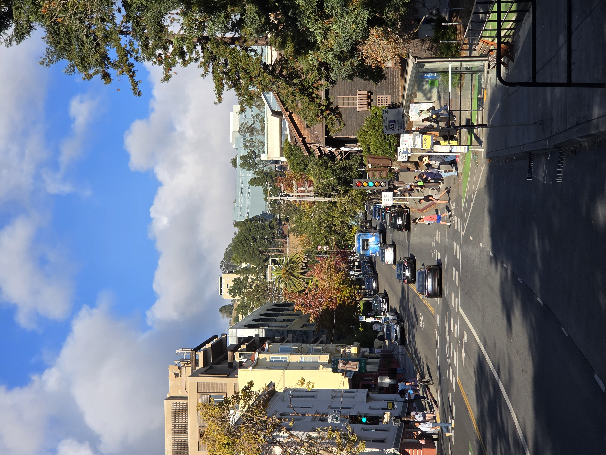
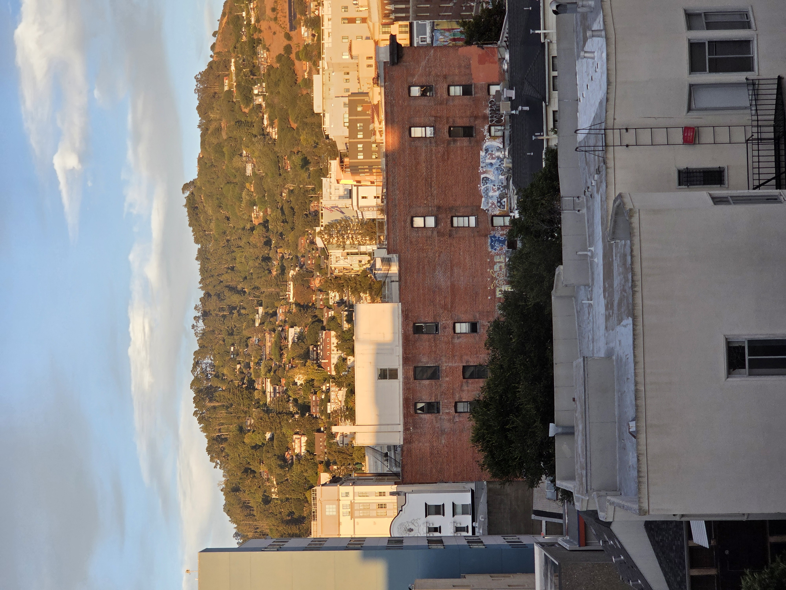
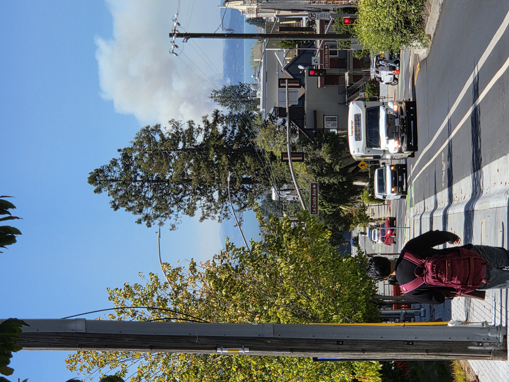
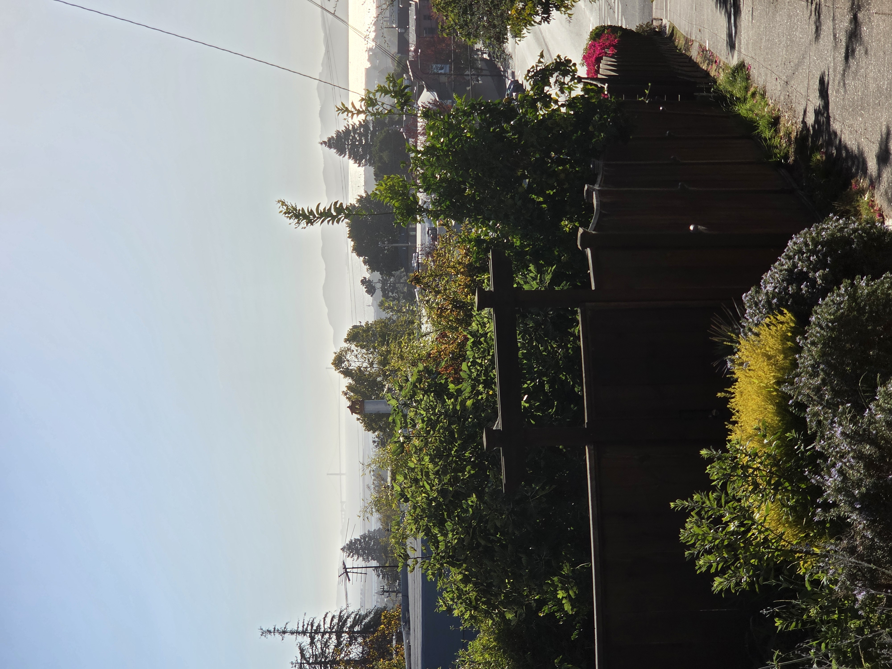
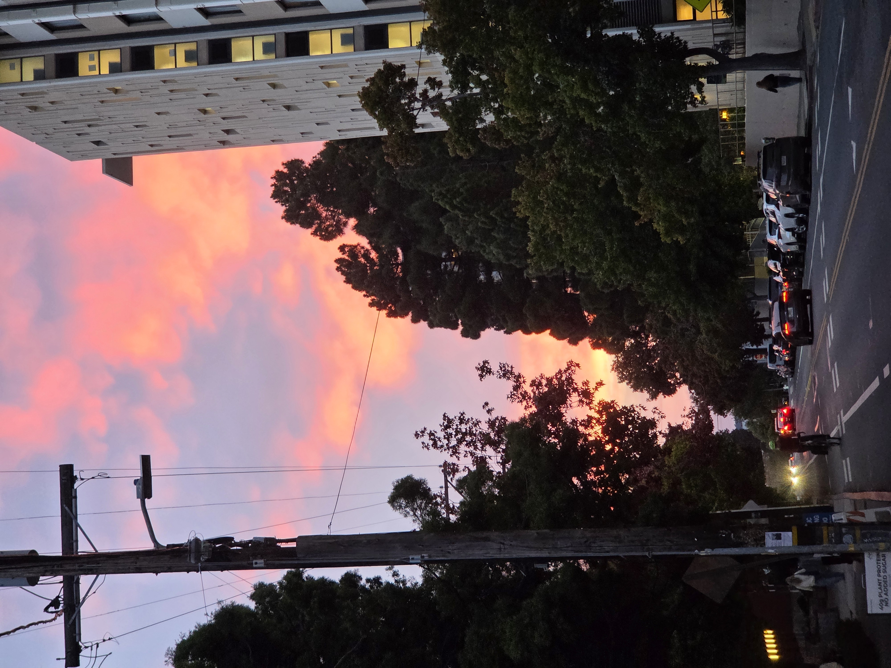
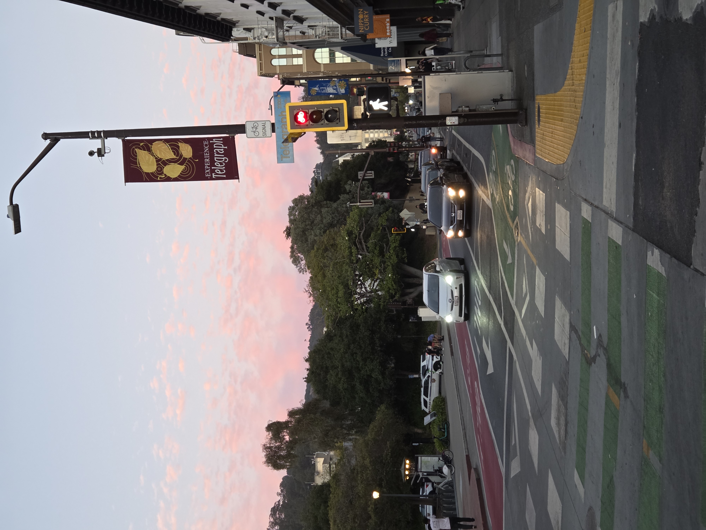
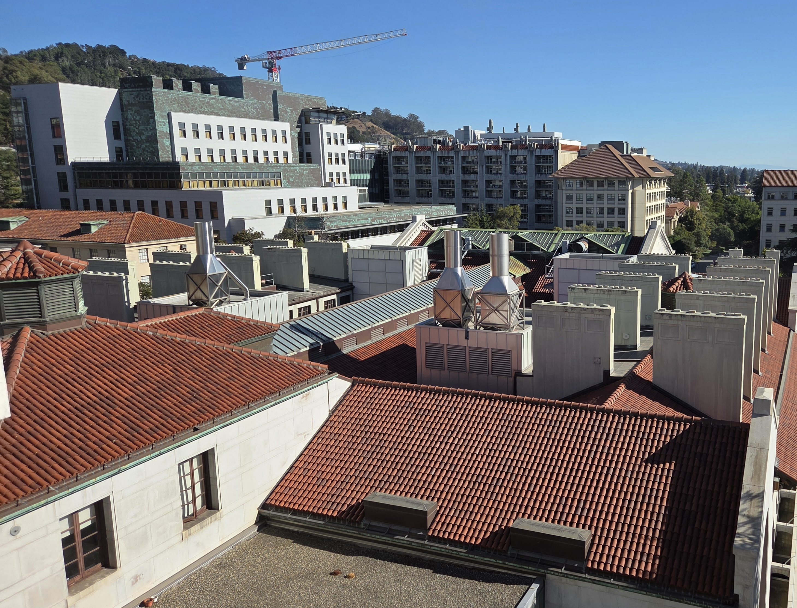
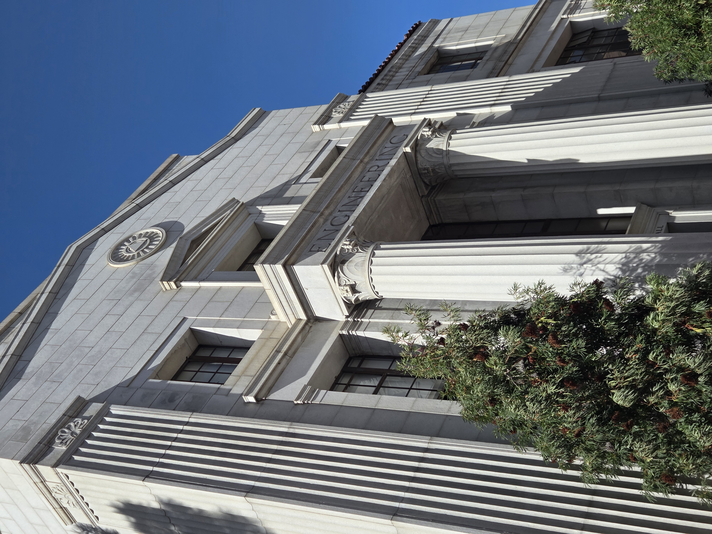
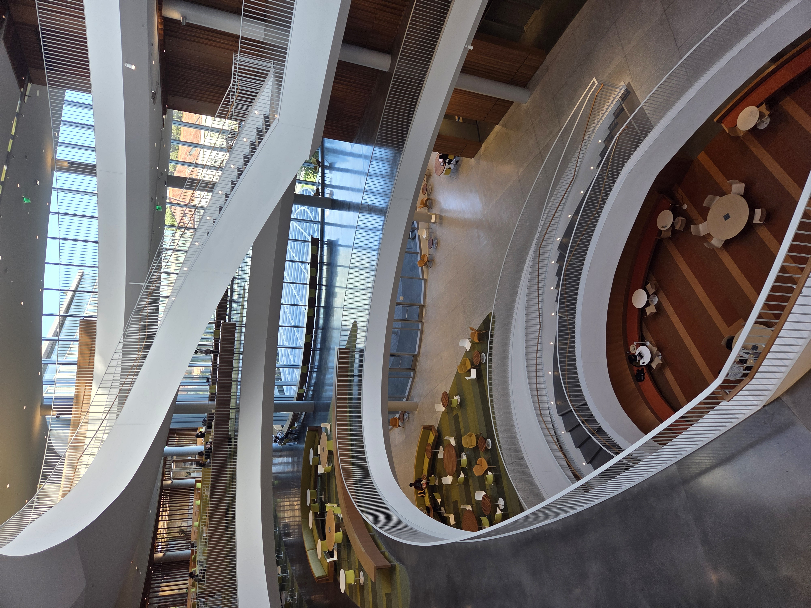
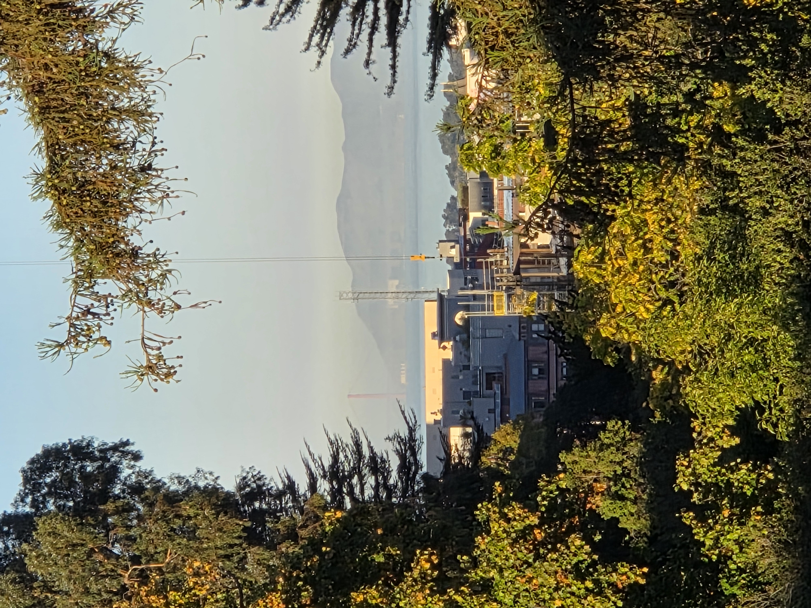
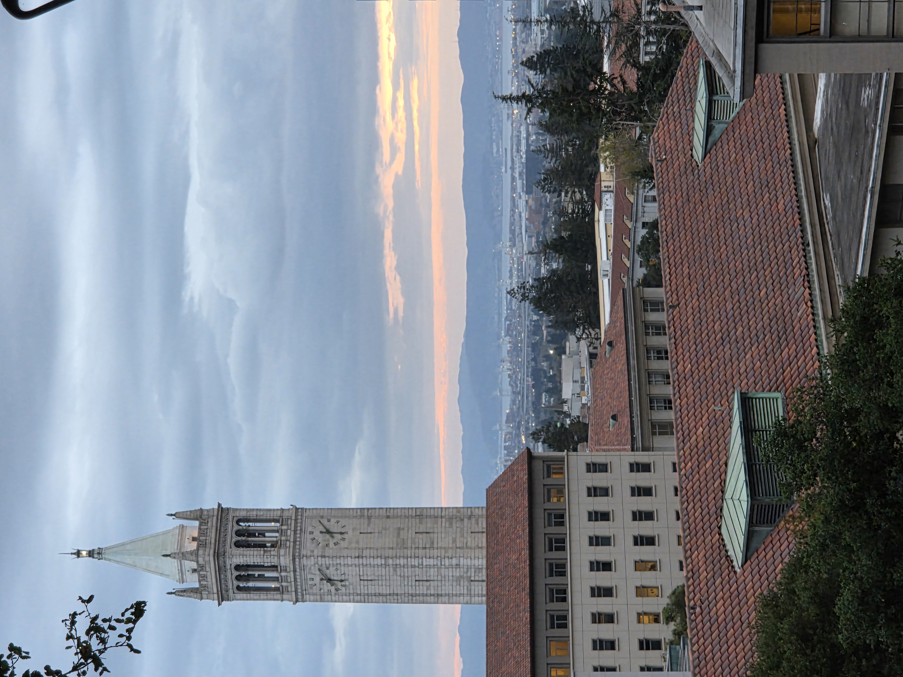
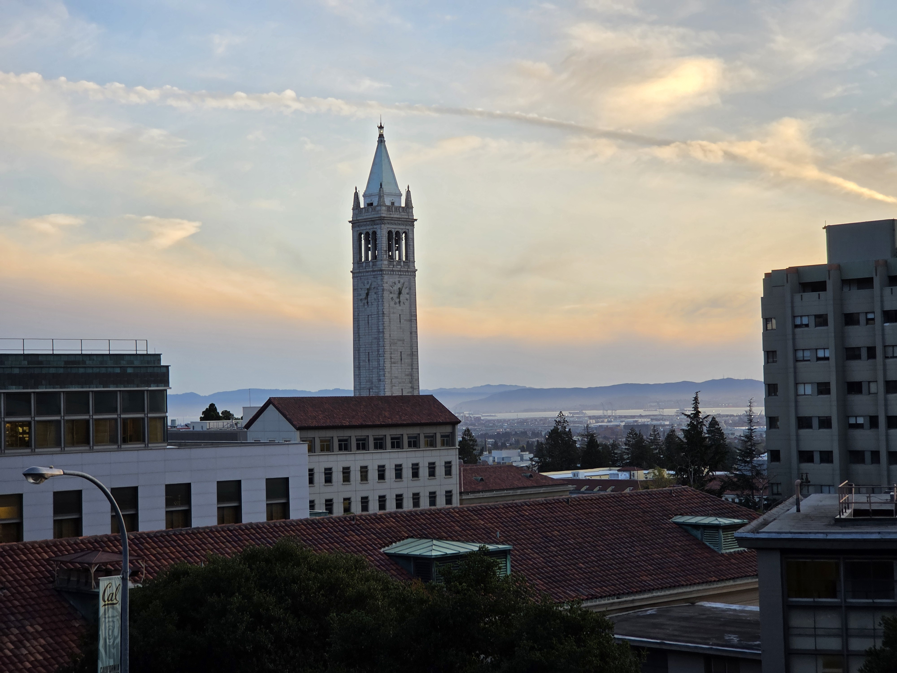
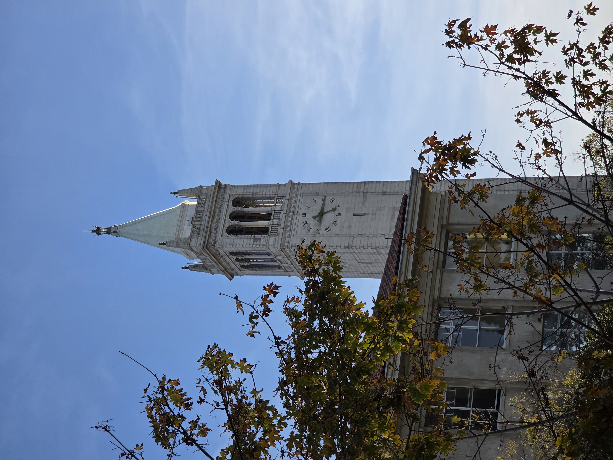
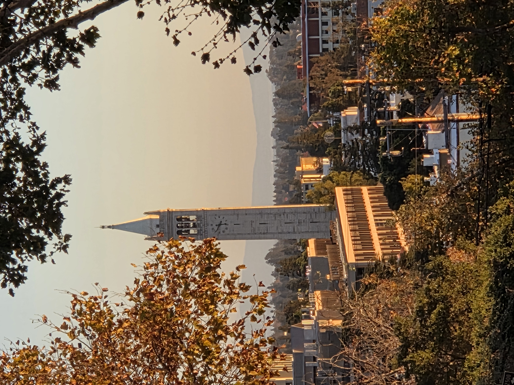

 
<!-- Headings are cool
======

You can have many headings
======

Aren't headings cool?
------  -->